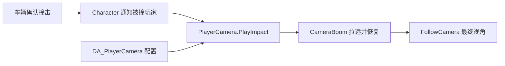

# 玩家镜头

角色保留 CameraBoom 和 FollowCamera，负责相机挂接和视角访问。DeliveryCameraComponent 处理镜头行为，DeliveryCameraConfig 保存编辑器参数

## 文件职责

| 文件或资源 | 内容 |
|---|---|
| Source/Delivery/Camera/DeliveryCameraComponent.h / .cpp | 读取配置、撞击反馈、每名玩家自己的计时和距离 |
| Source/Delivery/Camera/DeliveryCameraConfig.h | 参数定义、中文分类和取值限制 |
| Content/Blueprint/Camera/DA_PlayerCamera | 当前玩家使用的配置资源 |
| Source/Delivery/Character/DeliveryCharacter.cpp | 创建组件，保留服务器到拥有者客户端的撞击通知 |

## 在编辑器中调整

打开 DA_PlayerCamera，参数分成基础、跟随和撞击三组。BP_DeliveryMan 的 PlayerCamera 组件引用这份资源，开始游戏时把基础和跟随设置应用到原来的相机组件

| 想调整的表现 | 参数 |
|---|---|
| 平时看得更远 | 增大镜头距离 |
| 调整相机在角色旁边的位置 | 修改镜头偏移 |
| 显示更大的视野范围 | 增大视野角度 |
| 跟随柔和一些 | 开启平滑跟随位置，适当减小位置跟随速度 |
| 转向柔和一些 | 开启平滑跟随旋转，适当减小旋转跟随速度 |
| 撞击反馈更明显 | 增大额外拉远距离 |
| 远镜头停留更久 | 增大保持时间 |
| 撞击时快速拉开 | 增大拉远速度 |
| 撞击后慢慢恢复 | 减小恢复速度 |

配置在开始游戏时应用，修改后重新运行即可检查。没有指定配置资源时，保留原有相机组件的基础设置，撞击反馈采用代码默认参数。启用配置后，基础设置以配置资源为准，避免同时在弹簧臂和配置资源中调整同一个值

## 撞击时如何执行

服务器确认撞击后，角色通过原来的客户端通知调用 PlayImpact。组件检查角色是否由本机控制，只有拥有者播放反馈

第一次撞击记录当前弹簧臂距离，再开启组件更新。保持期间向外插值，时间结束后向原距离插值。恢复完成时精确还原距离，并关闭组件更新

连续撞击只延长保持时间，不重新记录距离，因此不会越撞越远。角色失去本机控制时清理反馈，避免之后重新控制时仍然处于拉远状态

配置资源只读，可以由多名角色共享。原距离、保持时间和反馈状态保存在每个组件实例中，不跨玩家共享，也不需要逐帧同步镜头距离

## 与现有系统的关系

CameraBoom 和 FollowCamera 的名称、挂接关系及 GetFollowCamera 入口保持不变，抓取瞄准和交互检测仍读取原来的相机。弹簧臂继续处理遮挡，镜头组件先更新臂长，弹簧臂再计算位置

摩托车有自己的镜头和上下车视角切换，本次没有把它并入玩家镜头组件。布娃娃的身体同步与角色根位置更新仍由原系统处理

## 验证记录

完整编译通过，原有 23 项自动化测试通过。新增 Delivery.Camera.Impact 测试通过，检查配置应用、撞击拉远、连续触发、距离恢复、关闭更新、失去控制和未配置资源时的行为

测试报告中有测试世界清理时的 EndPlay 警告，镜头功能断言全部通过。配置资源已保存，并在重启编辑器后确认角色蓝图仍然引用该资源

双人 PIE 检查通过：服务器通过原客户端通知触发镜头反馈，拥有者客户端距离从 400 拉远到约 518，再恢复到 400，其他角色镜头始终为 400，恢复后组件停止更新。此检查验证通知和镜头隔离，不包含车辆实际碰撞过程
