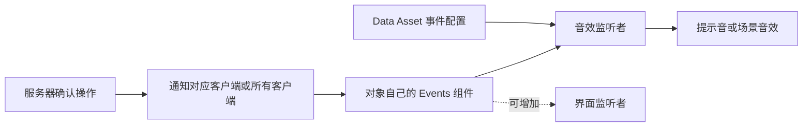
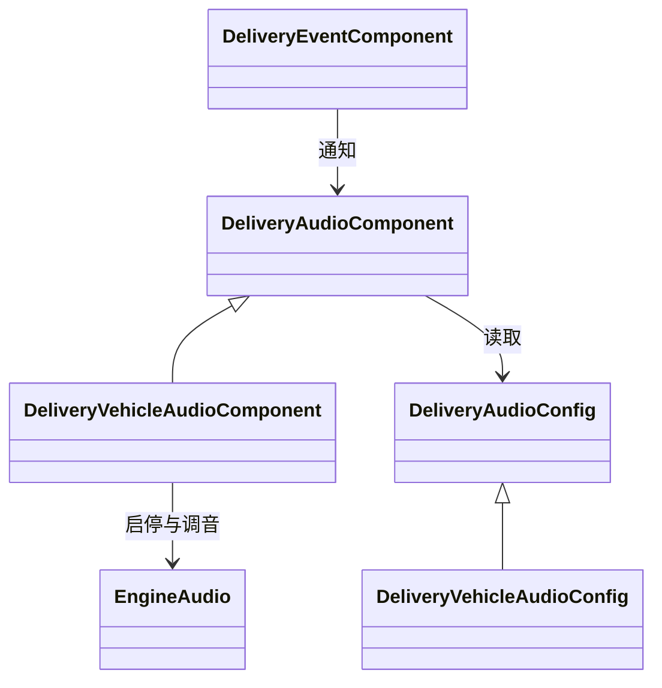

# 事件与游戏音效

角色和车辆负责判断操作是否成功，事件组件负责通知监听者，音效组件负责决定怎样播放。一次性声音使用配置表，发动机保留独立的持续播放逻辑

## 代码组织

| 文件 | 职责 |
|---|---|
| Events/DeliveryEventComponent.h / .cpp | 定义事件名称，向当前对象的监听者发出通知 |
| Audio/DeliveryAudioConfig.h | 事件与声音的对应关系，以及发动机参数 |
| Audio/DeliveryAudioComponent.h / .cpp | 订阅事件、查配置、播放提示音或场景音效 |
| Audio/DeliveryVehicleAudioComponent.h / .cpp | 复用事件音效播放，增加发动机启停和速度调音 |
| Audio/DeliveryMusicComponent | 背景音乐切换、淡入淡出和通话时降低音量 |
| Audio/DeliveryDialogueVoiceComponent | 根据文本生成电子语音 |

以上代码位于 Source/Delivery 下

## 取件和交付

服务器仍通过 Character 的 ClientPickupSucceeded 或 ClientDeliverySucceeded 通知操作玩家。这两个函数现在只发布成功事件，不再保存声音资源或调用播放函数

PlayerAudio 在 BeginPlay 中订阅同一个角色的 Events。事件到达后，根据 Config 的 Sounds 表查找声音。没有配置或声音留空时不播放，不影响其他监听者响应

提示音只向当前操作玩家播放。事件组件本身不复制，也不会把通知自动发送给其他世界或其他角色。服务器的成功判断和客户端通知仍然是明确的两步

## 车辆事件与发动机

上下车、召唤和撞击沿用原来的不可靠多播通知，各客户端收到后发布自己这辆车的事件。切换视角只在本机发布。事件名称使用枚举，不再用 0、1、2、3 表示不同操作

VehicleAudio 继承 DeliveryAudioComponent，因此一次性音效仍走同一套订阅和配置逻辑。它额外管理发动机循环音，复用原来的 EngineAudio 组件，挂接位置和衰减设置不变

车辆每帧先完成移动，再把驾驶状态和速度比例交给 UpdateEngine。没有驾驶员就停止声音；行驶时取速度的绝对值，把音调和音量从怠速值插值到高速值。倒车同样按速度大小发声，超过最高速度后不再继续升调。远端车辆使用已复制的速度，本机和服务器使用当前速度，与拆分前一致

## 编辑器配置

| 配置资源 | 使用者 |
|---|---|
| /Game/Sound/Config/DA_PlayerAudio | BP_DeliveryMan 的 PlayerAudio |
| /Game/Sound/Config/DA_VehicleAudio | BP_Motorbike 的 VehicleAudio |

打开资源，在“事件与声音”中选择事件，填写声音、音量、音调和“在场景中播放”

| 事件 | 播放方式 | 当前资源 |
|---|---|---|
| 取件成功 | 操作玩家的提示音 | SFX_Task_Pickup |
| 交付成功 | 操作玩家的提示音 | SFX_Task_Delivered |
| 上车、下车、召唤、车辆受撞 | 在车辆位置播放 | 沿用原配置，当前留空 |
| 切换视角 | 操作玩家的提示音 | 沿用原配置，当前留空 |

“在场景中播放”决定使用对象的世界位置，声音是否随距离衰减仍由声音资源的衰减设置决定。提示音不使用世界位置，只在拥有者本机播放

DA_VehicleAudio 还包含发动机设置：循环资源为 Motor_loop，怠速与高速音调为 0.8 和 1.7，怠速与高速音量为 0.15 和 0.5。这些数值来自原蓝图，不是重新设定的默认值

配置资源可以共享，播放时不会修改配置。事件订阅和循环声音组件分别属于各自对象，结束时解除订阅并停止发动机

## 增加事件或播放方式

增加同类音效时，在 EDeliveryEvent 中添加明确的事件名称，选择合适的业务位置发布，然后在配置表中填写声音。不要为了换一条声音再建立一个播放类

如果播放过程不同，例如需要持续跟随速度或持续合成语音，再使用独立组件。车辆音效展示了这里的继承关系：共用一次性事件播放，只增加发动机行为

界面若要响应同一事件，可以订阅 Events 的 OnEvent，不需要经过音效组件。监听者在结束时必须解除绑定

事件用于通知已经发生的操作，不保存完整任务状态。界面初始化和断线恢复仍应读取原任务系统的状态，不能只依赖一次性事件；现有任务状态委托继续保留，没有再复制成第二套状态通知

## 本次范围

本次迁移角色取件与交付提示、车辆一次性声音和发动机循环音。背景音乐、人物电子语音及电话铃声继续保留原来的专用流程，尚未统一接入这组事件。背景音乐的定时状态检查本次未改动

音效生成脚本 Content/Python/generate_gameplay_sfx.py 已改为写入 DA_PlayerAudio，避免再次向角色旧字段写入配置

## 验证

完整编译和 25 项自动化测试通过，其中新增 Delivery.Audio.Events 检查事件隔离、配置读取、解绑及发动机参数。重启后确认角色、车辆蓝图和地图实例的配置保留。双人 PIE 中，取件与交付通知仅到达对应玩家，下车事件在服务器和客户端各收到一次，两端发动机都在上车后播放、下车后停止。此次检查验证事件路由和播放状态，不包含对音质的主观试听，也没有验证延迟或丢包场景
