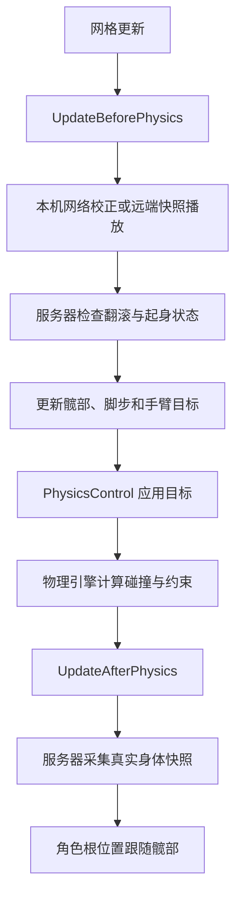

# 布娃娃更新与状态分工

角色仍然使用一个 DeliveryActiveRagdollComponent。它创建物理控制器，接收移动、出拳和倒地请求，并按固定顺序更新身体。内部状态对象不注册 Tick，也不创建另一套物理模拟。

## 一帧如何执行

网格先完成本帧的骨骼更新，随后进入布娃娃的物理前更新，PhysicsControl 再读取控制目标，最后由物理引擎计算真实身体运动。物理结束后，服务器采集快照，角色根位置跟随实际髋部位置。

这张图描述的是完整控制路径。远端角色和正在播放起身快照的客户端，在应用快照后就结束物理前更新，不继续生成本机行走目标。普通本机角色先接受服务器的位置校正，再根据当前输入计算目标。服务器还负责翻滚与起身条件的判定。

UpdateActionState 在物理前后入口都会运行，检查斧头是否仍被持有，以及受击效果是否到期。这里保留原来的执行时机，避免重构改变动作取消和身体支撑恢复的时刻。

## 状态由谁保存

| 对象 | 保存内容 | 修改方式 |
| --- | --- | --- |
| 主组件 | 身体模式、物理组件、蓝图参数、复制字段、身体支撑 | 初始化、状态切换和物理应用集中执行 |
| Movement | 移动输入、地面缓存、停步支撑、左右脚步与跳跃进度 | 步态与初始化流程更新，网络位移通过 Translate 与 CorrectStandAnchor 调整 |
| Punch | 当前出拳方向、左右手、是否释放 | Begin、Release、End 修改，其他流程只读取 |
| Recovery | 落地稳定计时、站稳计时、起身高度与进度 | 通过连续条件计时和起身方法推进，主组件决定是否切换身体模式 |
| Network | 前后两包快照、接收时间、采样计时、已处理序号与起身交接 | Receive 接收，ConsumeOwnerCorrection 限制重复校正，等待新快照后交回控制 |
| BoxingPose | 手臂目标与收拳过渡 | 根据当前动作指令、抓取目标和斧头动画更新手臂 |

Movement 是主组件内部的步态数据集合，步态算法仍与物理控制一起执行。本次没有把所有解算都改成独立对象；优先明确状态归属和跨模块修改入口，避免新增 Tick 顺序和物理写入竞争。

## 走路为什么不会被网络校正打断

平时的本机网络校正使用全身相同的速度增量，保持手脚相对身体的运动。每包快照只处理一次，重复 Tick 不会重复叠加校正速度。

偏差过大时，ApplyOwnerTranslation 平移身体，随后调用 Movement.Translate 同步移动脚步起点、落点、髋部目标、地面缓存和停步支撑位置。脚步进度、目标速度与控制开关保持原值。小幅校正通过 CorrectStandAnchor 调整停步支撑，避免站立电机继续把身体拉向旧位置。

## 出拳结束与收拳是两件事

Punch.Begin 记录水平方向和左右手，Release 表示拳头已经释放，End 结束当前攻击指令。End 保留最后一次拳路，因为躯干和手臂还需要沿原方向完成过渡。

BoxingPose 继续保存收拳过程。躯干支撑会检查它是否仍有待完成的收拳，因此攻击窗口结束后不会立刻撤掉支撑。这里没有改变蓄力时间、出拳冲量、命中窗口或收拳曲线。

## 起身后何时交回本机控制

服务器根据地面、身体速度和躯干姿态决定是否恢复。Recovery 只记录条件连续成立的时间和起身进度，不能自行打开电机或修改复制模式。

客户端起身期间播放服务器快照。收到 Active 模式后，Network 记下当前快照序号，继续等待一包新的姿态。新姿态到达后，主组件先应用它，再以当前位置重建控制目标，最后打开本机电机。重复旧快照不会提前交回控制，序号回绕到零也不会阻止交接。

## 文件位置

- 主入口：Source/Delivery/Ragdoll/DeliveryActiveRagdollComponent.cpp
- 步态数据：Source/Delivery/Ragdoll/Movement/DeliveryRagdollMovement.h
- 身体与脚步计算：Movement/DeliveryActiveRagdollStance.cpp、DeliveryActiveRagdollGait.cpp
- 恢复进度：Movement/DeliveryRagdollRecovery.h
- 地面与恢复条件：Movement/DeliveryActiveRagdollGround.cpp
- 出拳指令：Combat/DeliveryRagdollPunch.h
- 快照管理：Network/DeliveryRagdollSync.h
- 快照格式：Network/DeliveryRagdollSnapshot.h
- 网络物理应用：Network/DeliveryActiveRagdollNetwork.cpp
- 只读诊断：Debug/DeliveryRagdollDiagnostics.cpp

蓝图仍配置 BP_DeliveryMan 上原有的 ActiveRagdoll 组件，物理资产仍使用现有配置。复制模式、快照格式、骨骼参数及编辑器调参入口保持不变。

本轮验证：127 项 UE 属性声明保持一致；完整编译与 23 项自动化通过（5 项带警告、无失败）。低帧率出拳、收拳目标、步态和网络校正的诊断结果与重构前一致；网络校正测试新增起身交接和快照序号回绕检查。

### 双人运行检查

在 TestForCharacter 地图使用监听服务器和一个客户端，通过客户端实际输入完成前进、横移、后退和一次右拳

三段移动的平均速度分别为 63.33、68.34、63.30 厘米每秒，重构前保留的采样为 56.84、58.43、60.42 厘米每秒，本次采样未出现移动变慢；两次运行帧率并不完全相同，因此这些数值不能作为性能提升的结论

客户端与服务器均记录到了出拳开始、释放和结束，双人运行未安排贴身击打，所以不能据此确认实际命中和打晕；命中与恢复另由现有自动化测试检查，复杂地形、延迟和丢包下的表现仍需要专项测试
