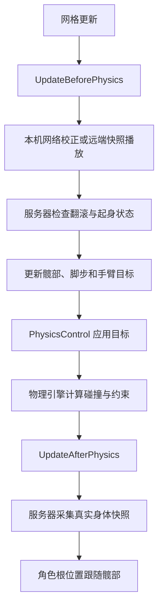

# 布娃娃更新与状态分工

角色仍然使用一个 DeliveryActiveRagdollComponent。它创建物理控制器，接收移动、出拳和倒地请求，并按固定顺序更新身体。内部状态对象不注册 Tick，也不创建另一套物理模拟。

## 一帧如何执行

网格先完成本帧的骨骼更新，随后进入布娃娃的物理前更新，PhysicsControl 再读取控制目标，最后由物理引擎计算真实身体运动。物理结束后，服务器采集快照，角色根位置跟随实际髋部位置。



这张图描述的是完整控制路径。远端角色和正在播放起身快照的客户端，在应用快照后就结束物理前更新，不继续生成本机行走目标。普通本机角色先接受服务器的位置校正，再根据当前输入计算目标。服务器还负责翻滚与起身条件的判定。

UpdateActionState 在物理前后入口都会运行，检查斧头是否仍被持有，以及受击效果是否到期。这里保留原来的执行时机，避免重构改变动作取消和身体支撑恢复的时刻。

## 状态由谁保存

| 对象 | 保存内容 | 修改方式 |
| --- | --- | --- |
| 主组件 | 身体模式、物理组件、蓝图参数、复制字段、身体支撑 | 初始化、状态切换和物理应用集中执行 |
| Movement | 移动输入、地面缓存、停步支撑、左右脚步与跳跃进度 | 步态与初始化流程更新，网络位移通过 Translate 与 CorrectStandAnchor 调整 |
| Punch | 当前出拳方向、左右手、是否释放 | Begin、Release、End 修改，其他流程只读取 |
| Recovery | 卡脚释放、交叉确认、补步超时、落地稳定计时与起身进度 | 通过连续条件计时和起身方法推进，主组件决定是否切换身体模式 |
| Network | 前后两包快照、接收时间、采样计时、已处理序号与起身交接 | Receive 接收，ConsumeOwnerCorrection 限制重复校正，等待新快照后交回控制 |
| BoxingPose | 手臂目标与收拳过渡 | 根据当前动作指令、抓取目标和斧头动画更新手臂 |

Movement 是主组件内部的步态数据集合，步态算法仍与物理控制一起执行。本次没有把所有解算都改成独立对象；优先明确状态归属和跨模块修改入口，避免新增 Tick 顺序和物理写入竞争。

## 走路为什么不会被网络校正打断

平时的本机网络校正使用全身相同的速度增量，保持手脚相对身体的运动。每包快照只处理一次，重复 Tick 不会重复叠加校正速度。

偏差过大时，ApplyOwnerTranslation 平移身体，随后调用 Movement.Translate 同步移动脚步起点、落点、髋部目标、地面缓存和停步支撑位置。脚步进度、目标速度与控制开关保持原值。小幅校正通过 CorrectStandAnchor 调整停步支撑，避免站立电机继续把身体拉向旧位置。

## 出拳结束与收拳是两件事

Punch.Begin 记录水平方向和左右手，Release 表示拳头已经释放，End 结束当前攻击指令。End 保留最后一次拳路，因为躯干和手臂还需要沿原方向完成过渡。

BoxingPose 继续保存收拳过程。躯干支撑会检查它是否仍有待完成的收拳，因此攻击窗口结束后不会立刻撤掉支撑。这里没有改变蓄力时间、出拳冲量、命中窗口或收拳曲线。

## 起身后何时交回本机控制

服务器根据地面、身体速度和躯干姿态决定是否恢复。Recovery 只记录条件连续成立的时间和起身进度，不能自行打开电机或修改复制模式。

客户端起身期间播放服务器快照。收到 Active 模式后，Network 记下当前快照序号，继续等待一包新的姿态。新姿态到达后，主组件先应用它，再以当前位置重建控制目标，最后打开本机电机。重复旧快照不会提前交回控制，序号回绕到零也不会阻止交接。

## 文件位置

- 主入口：Source/Delivery/Ragdoll/DeliveryActiveRagdollComponent.cpp
- 步态数据：Source/Delivery/Ragdoll/Movement/DeliveryRagdollMovement.h
- 身体与脚步计算：Movement/DeliveryActiveRagdollStance.cpp、DeliveryActiveRagdollGait.cpp
- 恢复进度：Movement/DeliveryRagdollRecovery.h
- 地面与恢复条件：Movement/DeliveryActiveRagdollGround.cpp
- 出拳指令：Combat/DeliveryRagdollPunch.h
- 快照管理：Network/DeliveryRagdollSync.h
- 快照格式：Network/DeliveryRagdollSnapshot.h
- 网络物理应用：Network/DeliveryActiveRagdollNetwork.cpp
- 只读诊断：Debug/DeliveryRagdollDiagnostics.cpp

蓝图仍配置 BP_DeliveryMan 上原有的 ActiveRagdoll 组件，物理资产仍使用现有配置。复制模式、快照格式、骨骼参数及编辑器调参入口保持不变。

本轮验证：127 项 UE 属性声明保持一致；完整编译与 23 项自动化通过（5 项带警告、无失败）。低帧率出拳、收拳目标、步态和网络校正的诊断结果与重构前一致；网络校正测试新增起身交接和快照序号回绕检查。


### 双人运行检查

在 TestForCharacter 地图使用监听服务器和一个客户端，通过客户端实际输入完成前进、横移、后退和一次右拳

三段移动的平均速度分别为 63.33、68.34、63.30 厘米每秒，重构前保留的采样为 56.84、58.43、60.42 厘米每秒，本次采样未出现移动变慢；两次运行帧率并不完全相同，因此这些数值不能作为性能提升的结论

客户端与服务器均记录到了出拳开始、释放和结束，双人运行未安排贴身击打，所以不能据此确认实际命中和打晕；命中与恢复另由现有自动化测试检查，复杂地形、延迟和丢包下的表现仍需要专项测试


## 脚交叉与卡脚恢复

`DeliveryActiveRagdollGait.cpp::UpdateFootRecovery` 读取双脚实际质心，用骨盆真实右方向计算 `Dot(RightFoot - LeftFoot, Right)`。负数表示左右顺序颠倒。默认颠倒超过 3 厘米且持续 0.18 秒，才向 `FDeliveryRagdollRecovery` 报告 `FeetCrossed`。

Recovery 保存恢复状态，不直接写刚体。主组件在计算髋部目标前推进它，恢复期间暂停前进目标并保留玩家输入。开始时取消旧步伐，释放 0.12 秒；随后沿原有地面探测和抬脚轨迹，优先调整偏离自身一侧更严重的脚。释放和补步期间暂停侧向分离力，避免脚目标与额外拉力相互冲突。这里没有将历史姿态直接写回身体，也没有关闭物理模拟。

双脚停止摆动、左右间隔达到 `StableMinimumFootSide` 并连续保持 0.15 秒后退出。补步超过 2 秒也会清理未完成目标并退出，之后等待 0.5 秒才允许再次确认交叉。跳跃、起身、抓取、攻击及收拳时取消交叉观察，避免抢占现有动作。普通卡脚仍使用原来的 0.45 秒释放，但计时已移入 Recovery，重复通知不会延长它。

```text
物理脚位 → 持续交叉确认 → ReportIssue(FeetCrossed)
                              ↓
                撤销旧步伐 → 短暂释放 → 单脚补步
                                         ↓
                              连续稳定或超时 → 恢复行走
```

`Ragdoll|恢复` 中可以调整交叉确认距离、确认时间、双脚稳定等待和补步最长时间。转身误触发时先增加确认时间；恢复反复进出时检查落点与碰撞，不直接增加驱动力。当前只检测脚交叉与迈步失败，没有用速度阈值判断全身抽搐。

本机与服务器沿既有主动步态路径分别执行，远端只播放服务器快照，没有新增全局事件或另一套 Tick。`Delivery.Ragdoll.FootRecovery` 检查短暂交叉、连续确认、重复通知、稳定退出、超时和重试；多人手感仍需双人 PIE 验证。

验证：DeliveryEditor 编译通过，FootRecovery、FootSeparation、LegIsolation、NetworkCorrection、PlayerRecoveryTargets 五项自动化通过。尚未人工验收双人 PIE 的转身、坡面和受击手感。


## 战斗异常交给同一个 Recovery

`EndBodyDrivenPunch` 在出拳结束时调用 `Recovery.WatchArm`，观察刚出拳的那只手，最长观察 3 秒。BoxingPose 先完成原有收拳；不能把正常收拳中的姿态偏差当作异常。

`UpdateArmRecovery` 只在身体站稳、没有攻击、挥斧、抓取或受击时检查。正常收拳结束后，上臂或小臂与控制目标的旋转偏差超过 70 度并持续 0.45 秒，调用 `ReportIssue(ArmBlocked)`。Recovery 保存时序，BoxingPose 保存恢复起点并执行目标插值。

```text
出拳结束 → WatchArm → 正常收拳完成 → 持续偏离目标
                                       ↓
                          ReportIssue(ArmBlocked)
                                       ↓
                  记录实际旋转 → 平滑恢复正常目标 → 结束
```

恢复默认持续 0.65 秒，同一拳最多尝试一次。期间暂不接受新出拳，但不暂停走路。抓取、挥斧、受击、离地或倒地会取消手臂恢复。首帧重建目标时将目标角速度置零，避免旧目标到实际姿态的差值造成突发驱动；刚体的位置和速度不会被直接修改。持续有障碍挡住手臂时不反复强拉，需要通过诊断工具检查碰撞。

编辑器 `Ragdoll|恢复` 下的“手臂异常角度”“手臂异常确认时间”“手臂恢复时间”控制这些阈值。上臂按世界旋转比较，小臂按相对上臂旋转比较，不能直接混用两个坐标系。

## 实时姿态诊断工具

打开“窗口 → Delivery 布娃娃与出拳调参 → 实时诊断”。开始 PIE 后点击“刷新运行中的角色”，按世界编号、网络身份和角色名称选择对象，再勾选“开启实时诊断”。走路和战斗的标记可以分别关闭。

| 标记 | 内容 |
| --- | --- |
| 绿球 | 双脚、髋部、拳头的实际物理位置 |
| 青球 | 当前启用的脚部控制目标和髋部目标 |
| 黄线 | 实际位置到目标的偏差 |
| 白箭头 | 骨盆真实右方向，用于核对左右投影 |
| 红球或红线 | 持续交叉、迈步未到位或手臂偏差，需要结合碰撞检查 |
| 橙球和橙线 | 服务器命中窗口内最后记录的拳头扫掠起点、终点与半径 |

面板同时显示双脚投影、直立值、脚目标偏差、手臂旋转偏差，以及蓄力、释放、收拳、脚步恢复和手臂异常恢复状态。脚标记使用本帧电机目标，不把最终落点误标为当前目标。手臂连线连接物理刚体原点，用于查看姿态，不是精确关节表面。

诊断告警与自动恢复不是同一个条件：交叉和落脚延误持续 0.2 秒会提示，战斗期间手臂偏差超过 60 度持续 0.25 秒会提示；自动手臂恢复还要求正常收拳已经结束。红色不表示已经确认代码故障，被墙挡住也可能出现偏差。当前没有把全身快速运动直接判成抽搐。

远端角色仅显示实际姿态，不用旧控制目标触发告警；专用服务器没有视口，只查看面板数据。同进程 PIE 可在列表中选择各世界，独立进程不在该编辑器的对象列表中。

工具通过只读的 `ReadPoseDebug` 获取快照，不修改姿态、输入、命中或角色配置。运行时不引用编辑器模块。采样绑定所选 PIE 世界的 OnWorldPostActorTick，不依赖面板 Tick，切回游戏或面板被其他标签遮住后仍继续更新。绘制使用独立的临时 LineBatchComponent，每帧替换标记并更新绘制范围，角色远离原点后也不会沿用旧范围；暂停 PIE 不累积图形，关闭诊断、切换页面、切换角色或退出 PIE 时销毁自己的绘制组件，不清除其他工具的标记。

源码：`Ragdoll/Debug/DeliveryPoseDebug.h/.cpp` 提供只读数据，`Plugins/DeliveryTuning/Source/DeliveryTuning/Private/SDeliveryPoseDebug.h/.cpp` 负责角色选择、分类显示和清理。

验证补充：新增恢复与诊断快照检查已随 28 项 Delivery 自动化通过，其中 6 项带警告。面板另有生命周期测试，检查重复绘制不累积、关闭时注销和退出 PIE 时释放对象。尚未人工验收诊断页的画面布局、双人视口标记与异常恢复手感。

持续显示修复已通过 DeliveryEditor 编译和 Delivery.Debug.PanelLifecycle 自动化，检查远处姿态的绘制范围、两次更新之间标记保留，以及停止诊断和退出 PIE 的清理
